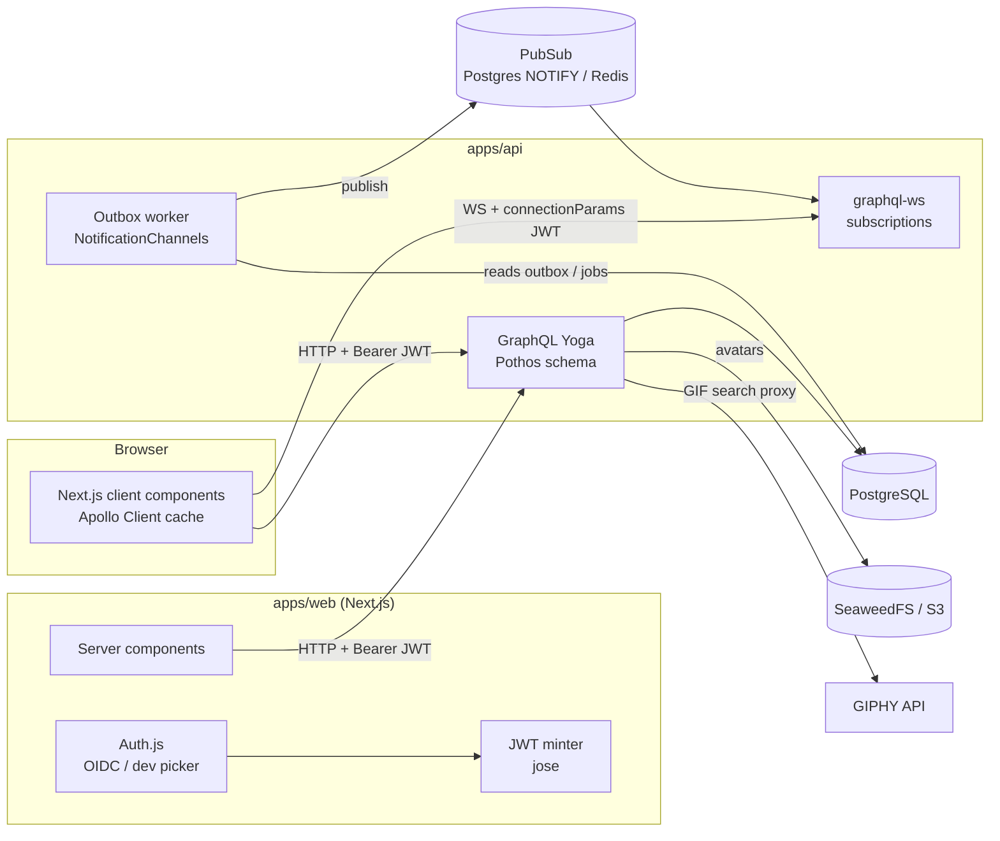
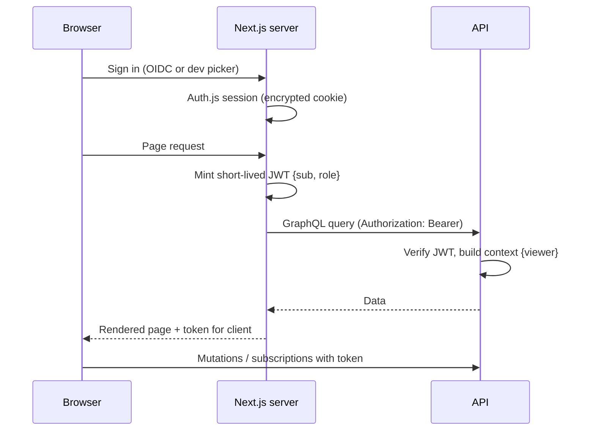

# Architecture

See the [Spec](SPEC.md) for what each part does, and the [ADRs](adr/) for why it was built this way.

## System overview



## Request auth flow



How the token gets to the client:

- The client fetches a token from a Next.js route handler (`/api/token`) and refreshes it before it expires.
- The token never goes into `localStorage`.

## Write path and notifications (outbox)

```mermaid
sequenceDiagram
  participant C as Client
  participant A as API resolver
  participant DB as Postgres
  participant W as Outbox worker
  participant P as PubSub
  C->>A: createKudo(...)
  A->>DB: BEGIN; insert kudo, recipients, mentions; insert outbox_event; COMMIT
  A-->>C: Kudo (Apollo cache updates)
  W->>DB: claim outbox_event
  W->>W: resolve audience (recipients, mentions…)
  W->>DB: insert notification rows (InAppChannel)
  W->>P: publish notificationAdded(userId)
  P-->>C: subscription push
```

- The domain write and its event are saved in **one transaction**, so a notification can never be lost because of a failure between two writes.
- Channels implement `NotificationChannel.deliver(event, recipient)`. Today the only one is `InAppChannel`.

## Swap points (interfaces)

| Interface             | Default (demo)                          | Real-world option       |
| --------------------- | --------------------------------------- | ----------------------- |
| `PubSub`              | Postgres LISTEN/NOTIFY                  | Redis                   |
| `FileStorage`         | SeaweedFS (S3 API)                      | S3 / R2                 |
| `NotificationChannel` | `InAppChannel`                          | + `EmailChannel`        |
| `UserDirectorySource` | Faker seed                              | HRIS / SCIM             |
| `SearchService`       | Postgres `pg_trgm` / `tsvector`         | Meilisearch / Typesense |
| `LeaderboardService`  | Live aggregate SQL                      | Materialized view       |
| `GifProvider`         | Bundled set, or GIPHY when a key is set | GIPHY                   |

## Monorepo layout

```
apps/
  web/        Next.js App Router
  api/        Yoga server + worker entry point
packages/
  ui/         CSS Modules + Radix components, Storybook
  db/         Drizzle schema, migrations, seed
  config/     tsconfig/eslint/prettier presets, brand.ts, env helpers
docs/         This vault source (synced to Obsidian)
scripts/      Repo tooling (docs-sync, …)
```
