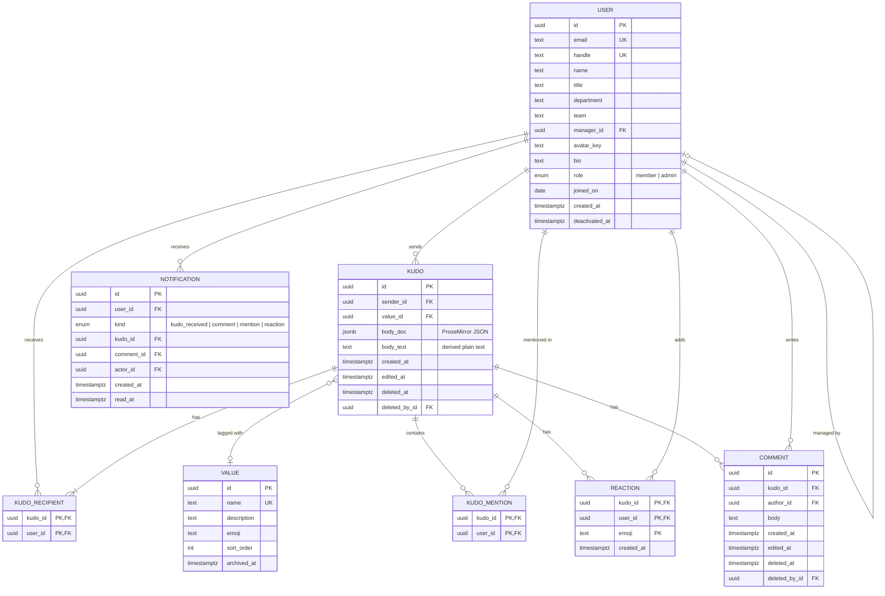

# Domain Model

The entities as implemented in `packages/db/src/schema.ts` (Phase 2). Term definitions are in the [Glossary](glossary.md). Every `id` is a time-ordered `uuidv7()`, and every timestamp is `timestamptz`.

A separate infrastructure table, `outbox_events`, holds `id`, `type`, `payload jsonb`, `created_at` and `processed_at`. pg-boss also keeps its own tables in a `pgboss` schema.

## Invariants

Enforced by the **database**:

- Unique: user email (case-insensitive), user handle, value name (case-insensitive); reactions on `(kudo_id, user_id, emoji)`.
- `kudos.body_text` is 1–500 characters, `comments.body` 1–1000, `users.bio` ≤ 280.
- Deleting a kudo row cascades to its recipients, mentions, reactions, comments and notifications. In practice kudos are only ever soft-deleted.

Enforced by the **API** (they span rows, so they live in the domain layer, with tests):

- `sender_id` must not appear in that kudo's `kudo_recipients` (no self-kudos).
- Each kudo has between 1 and 10 recipients.
- A kudo can only be created with a value that is **not archived**.
- Soft-deleted kudos (`deleted_at IS NOT NULL`) are excluded from feeds, profiles, leaderboards and notifications; admins see them in the audit view.
- Deactivated users (`deactivated_at` set) can't sign in, and API tokens for them are ignored. Their content stays visible, shown as "Former employee" to non-admins.

## Indexes

- `kudos (created_at DESC, id DESC) WHERE deleted_at IS NULL`: feed pagination.
- `kudo_recipients (user_id, kudo_id)`: profile "Received" tab and leaderboard.
- `kudos (sender_id, created_at DESC)`: profile "Given" tab.
- `users USING gin (… gin_trgm_ops)` on name, title and team: fuzzy people search.
- `notifications (user_id, created_at DESC)` and a partial index on unread: notification list and badge.
- `outbox_events (created_at) WHERE processed_at IS NULL`: worker queue.
